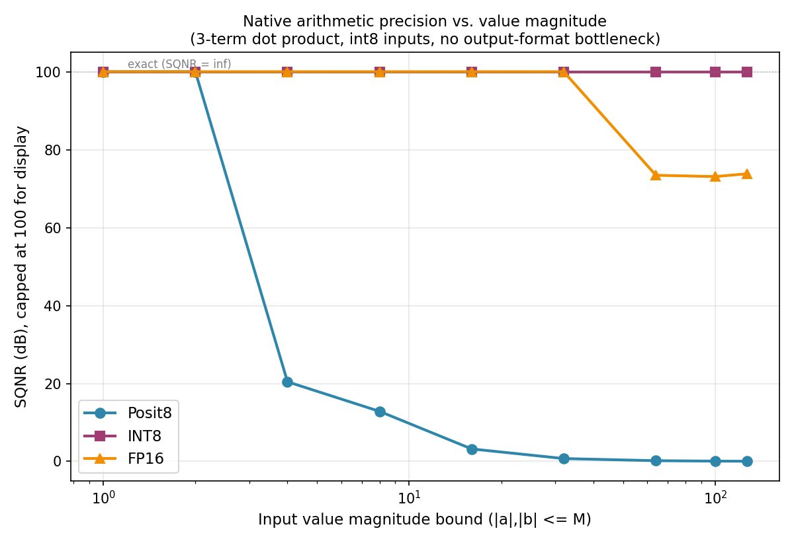
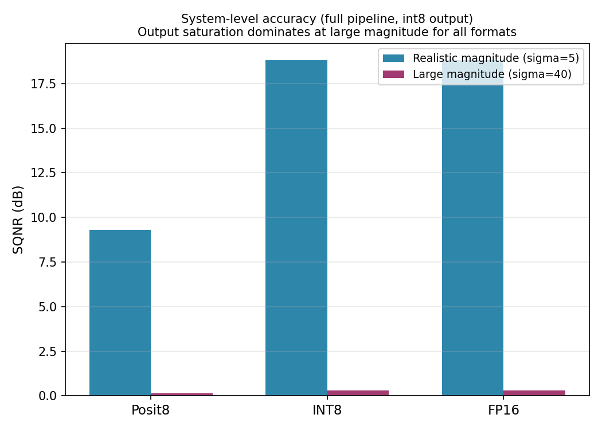

# Accuracy Benchmark: Posit8 vs INT8 vs FP16

Simulated bit-for-bit against each format's actual RTL implementation
(same encoders, same accumulation precision policy, same final
rounding step as `posit_systolic_top.v` / `int8_systolic_top.v` /
`fp16_systolic_top.v`), compared against a float64 reference. Full
methodology, code, and raw JSON results in `benchmark/`.

## Two separate questions, deliberately not conflated

**A - Native arithmetic precision.** Given the *same* int8 inputs (the
input-quantization step is identical across all three, since all three
accelerators take int8 input), how accurately does each format's
*internal* accumulator/output represent the true dot product, with no
shared output-width bottleneck? This isolates each format's intrinsic
numerical behavior - it's what a number-format comparison in the
literature (e.g. Gustafson's posit papers) actually measures.

**B - System-level, as-deployed.** The full RTL pipeline, including
the final round-down to this project's chosen 8-bit integer output.

Conflating these produces misleading comparisons: at large magnitude,
INT8 and FP16 report *identical* system-level numbers below - not
because their arithmetic is identical (it isn't - see Experiment A),
but because both are dominated by output saturation to `[-128,127]`,
which erases any accumulation-precision difference between them. This
is itself a real, reportable finding: **choice of output width matters
more than choice of arithmetic format once magnitudes exceed the
output's range.**

## Experiment A: native precision vs. magnitude

| \|value\| ≤ | Posit8 (dB) | INT8 (dB) | FP16 (dB) |
|---|---|---|---|
| 1   | inf | inf | inf |
| 2   | inf | inf | inf |
| 4   | 20.44 | inf | inf |
| 8   | 12.84 | inf | inf |
| 16  | 3.20 | inf | inf |
| 32  | 0.74 | inf | inf |
| 64  | 0.18 | inf | 73.43 |
| 100 | 0.08 | inf | 73.10 |
| 127 | 0.05 | inf | 73.81 |

**Why each curve looks the way it does:**

- **INT8 is exact at every magnitude tested.** Its accumulator is
  INT32 - vastly wider than needed for a 3-term product of int8
  values (max ~2^15) - so there is *no* rounding anywhere in
  accumulation. All of INT8's real-world error comes from output
  saturation (Experiment B), never from arithmetic.
- **Posit8 degrades smoothly and severely with magnitude** - the
  signature of *tapered precision*. Posit(8,0)'s regime field grows
  to encode a larger exponent, which directly steals bits from the
  fraction field (down to **zero** fraction bits at the format's
  extremes - see `posit8_pack.v`'s regime table). Near ±1, Posit8 is
  excellent (5 fraction bits); by ±64, it has none, and SQNR
  collapses to near 0 dB (noise power ≈ signal power).
- **FP16 stays exact up to magnitude 32, then settles at ~73 dB
  (not 0)** - a clean illustration of *why* floating point handles
  wide dynamic range so much better than a tapered format at the same
  bit width: FP16's 11-bit significand is *fixed size regardless of
  exponent*. It stays exact as long as the true integer sum fits
  within 11 bits (≤2048); beyond that it loses only the low bits of an
  already-large number, giving ~73 dB (roughly 12 effective bits)
  instead of Posit8's near-total collapse at the same magnitude.

## Experiment B: system-level (with int8 output), realistic vs. large magnitude

| | Realistic (σ=5), SQNR | Large (σ=40), SQNR |
|---|---|---|
| Posit8 | 9.29 dB | 0.15 dB |
| INT8   | 18.81 dB | 0.29 dB |
| FP16   | 18.81 dB | 0.29 dB |

At realistic (small-integer, weight/activation-like) magnitude, INT8
and FP16 both track the true value almost exactly internally, so the
only error left is the final round-to-nearest-int8 step - identical
for both, hence identical SQNR. Posit8 is worse here specifically
*because* it also carries its own internal tapered-precision error on
top of that same output rounding. At large magnitude, all three
converge toward ~0 dB as saturation to `[-128,127]` dominates
completely regardless of arithmetic format - the accelerator's output
width, not its number format, is the bottleneck at that point.

## Practical takeaway

- If your accumulated values will exceed the tapered-precision "sweet
  spot" of Posit(8,0) (roughly |value| > ~8-16 for this configuration),
  Posit8 pays a real, measurable accuracy cost relative to INT8 or
  FP16 - purely from vanishing fraction bits at wide regimes, not from
  a design bug.
- If your workload's true dynamic range is known to stay small (e.g.
  normalized/pre-scaled NN weights near ±1), Posit8's extra fraction
  bits *there* would show the opposite advantage - this benchmark's
  magnitude sweep is exactly the tool to find that crossover point for
  a specific workload; it isn't at magnitude 1 or 2 for this system
  (both format's precision is already lossless there), but shows up
  clearly by magnitude 4.
- INT8's accuracy story is entirely about **output width**, not
  arithmetic - a wider output (or a proper per-tensor requantization
  scale, out of scope here) would eliminate essentially all its error
  up to its INT32 accumulator's true range.
